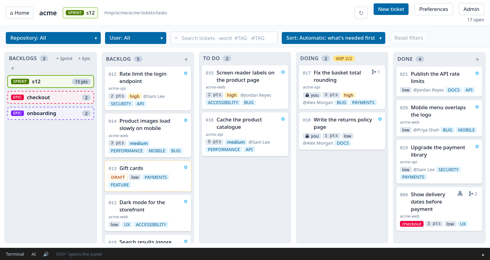

# KanRite user guide

How to use KanRite day to day: the command line (`rite`) and the desktop
board (`riteui`). For what it is and how to install it, see the
[README](../README.md); for building it yourself,
[CONTRIBUTING.md](../CONTRIBUTING.md).

## Contents

- [Getting started](#getting-started)
- [What's on a ticket](#whats-on-a-ticket)
- [Assignees](#assignees)
- [Related tickets](#related-tickets)
- [Your own columns](#your-own-columns)
- [The desktop board](#the-desktop-board)
- [Driving it from the command line](#driving-it-from-the-command-line)
- [The board in a terminal](#the-board-in-a-terminal)
- [My work, across every project](#my-work-across-every-project)
- [Ideas](#ideas)
- [Roadmaps](#roadmaps)
- [Statistics](#statistics)
- [Several repositories at once](#several-repositories-at-once)
- [Bringing in existing work](#bringing-in-existing-work)
- [Working together, and getting tickets back](#working-together-and-getting-tickets-back)
- [Who can change the project's settings](#who-can-change-the-projects-settings)
- [Using AI with KanRite](#using-ai-with-kanrite)
- [Shell completion](#shell-completion)
- [Coming from agile-md](#coming-from-agile-md)

## Getting started

Start a project, or join one:

```bash
rite init acme                     # make acme-tickets and acme-documents on GitHub and clone them here
rite join acme                     # …or join a project someone else made
rite init acme --local-only        # …or keep the board in the repository you're in (tasks/)
```

A team can mix Windows, macOS and Linux. Windows tools often save files
with Windows line endings (CRLF); rite reads those like any other and
always writes plain LF, so a ticket edited on one system reads the same on
every other. The repositories `rite init` creates also get a
`.gitattributes` asking git to keep text files LF in every clone.

Then, from any of its repositories (or the folder holding them):

```bash
rite new "Publish to Marketplace" --branch-type feature --repository acme-web --assignee @me
rite board                         # show all columns (the default)
rite todo    1                     # backlog -> todo, and switch acme-web to feature/publish-to-marketplace
rite doing   1                     # todo -> doing: locked to you while it's there
rite done    1                     # doing -> done
rite todo                          # no ref: list what's in todo/ instead of moving anything
rite show    publish               # print a task (id or slug substring)
rite edit    1                     # open in $EDITOR
rite abandon 1                     # take it off the board, into tasks/archive/ — and
                                   # delete its branch too, if it's still empty
rite mine                          # your todo and doing tickets, across every project on this machine
rite recover                       # tickets deleted or abandoned: who removed each, and when
rite recover 1                     # bring one back into the backlog, exactly as it was
rite renumber                      # two tickets with the same number: shows the fix
rite renumber --apply              # ...and makes it, in one commit
rite link    1 3                   # relate two tickets
rite tag     urgent                # list every ticket carrying a tag, across every column
rite tags                          # the project's tag list, with how many tickets carry each
rite tags add future               # add a tag (saved as FUTURE); `rite tags remove` takes an unused one off
rite new     "Idea" --draft        # a draft: tagged DRAFT, it stays in the backlog
rite ready   1                     # take it out of draft (`rite draft 1` puts it back)
rite todo    --tag urgent          # any listing form narrows to a tag: board, a
                                   # destination verb, or an epic by name
rite lock    1                     # claim a ticket so someone else's edits and moves
                                   # are refused until you release it or it lapses
rite unlock  1                     # release your own lease
rite unlock  1 --force             # break someone else's — a separate, deliberate act
```

`rite` works from any subdirectory — it resolves the board from the repo root,
and from a code repository it finds the project's tickets repository beside
it. Set `RITE_DIR` to use a board directory other than `tasks`.

## What's on a ticket

One kind of ticket, with sensible defaults — fill in what applies and leave the
rest:

| Field         | | |
| ------------- | --- | --- |
| `id`          | automatic | `007`, from the board's counter |
| `title`       | required | names the file, and the branch |
| `assignee`    | optional | who's doing it; assignable later |
| `priority`    | default `low` | `low`, `medium`, `high` or `top` (every TRIAGE ticket is top) |
| `points`      | optional | its size: 1, 2, 3, 5, 8 or 13 |
| `repository`  | optional | the repository it's about, where its branch is made |
| `branch-type` | optional | `feature`, `bugfix`, `hotfix`, `release`, `chore`, or `none` for no branch |
| `branch-name` | automatic | `<branch-type>/<title>`, empty without a branch type or with `none` |
| `parent`      | optional | the ticket this sits under, any depth |
| `related`     | optional | ids of tickets this relates to |
| `links`       | optional | typed links: `requires`, `supersedes` and the like |
| `tags`        | optional | always UPPERCASE; from the project's tag list (DRAFT and TRIAGE are always on it) |
| `created`     | automatic | the date |
| `created-by`  | automatic | who made it, `Name <email>`; never changes |
| `due`         | optional | when it's due, `YYYY-MM-DD`; past it and not done, it's overdue |
| `recur`       | optional | how it repeats: `weekly`, `fortnightly`, `monthly`, `quarterly`, `yearly`, or `every N days|weeks|months|years` |

**Who to ask.** `rite show` and the desktop board's editor say who created a
ticket and who last edited it: "created by Priya Shah on 2026-10-02; last
edited by Sam Lee on 2026-10-08". Last edited comes from git history (a move
between columns doesn't count), so an edit made in any editor is credited
to the right person. A ticket made before `created-by` existed is credited
from git, and gets the field the next time it's saved.

**Tags** are always UPPERCASE, so they stand out. Each project keeps a tag
list (Admin in the desktop board, or `rite tags`), saved in the tickets
repository's `.settings`. Every list starts with the built-in DRAFT and
TRIAGE; add the project's own with `rite tags add`. The editor offers the
list as a sorted dropdown, and a tag that isn't on it is refused: "Prevent
arbitrary tags" is on by default, so a new project allows only DRAFT and
TRIAGE until you add more. Turn it off (`rite tags only off`) to allow other tags, which `rite
new` then only warns about and the editor shows dashed. A tag can only be removed from
the list once no ticket carries it. Matching ignores case, so a ticket written
before tags were uppercase still matches.

**Due dates and recurring tickets.** Any ticket can have a due date: the
card shows it, red and marked overdue once the date has passed and it isn't
done, and `rite show` says so too. A ticket that comes round again (a
monthly report, a certificate renewal, a weekly backup check) gets a
repeat: when it's moved to done, the next one is made in the same commit,
a new ticket in the backlog with the same title, body (its checklist
unticked), tags, points, priority, repository and assignee, due one
interval after this one (or after today, if this one was done late) and
noting which ticket it follows. Nothing else makes a copy: an overdue one
just shows as overdue until it's done.

```bash
rite new "Renew the certificate" --recur yearly --due 2027-03-01
rite set 12 due 2026-11-30          # empty clears
rite set 12 recur "every 2 weeks"   # stored as fortnightly; empty stops it
```

In the editor they're **Due** and **Repeats**.

**Due dates on the board.** A ticket in the loose backlog that's made, or
given a due date, with 3 days or fewer left (or already overdue) goes
**straight to todo**, unless it's a draft; todo has no WIP limit, so
nothing stops it. `rite due-to-todo 5` changes the days, `0` turns it off,
and so does Admin → Due dates and the backlog. Other tickets with due
dates sit at the **top of the backlog**, soonest first. A ticket with a due
date **can't go in an epic**, since an epic has no end date: filing one
there, or dating one that's in an epic, is refused. A sprint can hold one,
but its column shows a warning listing them, and so does `rite s12`, so you
can check they fit. Admin's **Always show the backlog**
(`rite backlog-always-shown on`) stops the backlog column being folded
away. A 13-point ticket has a **red border**: break it into a parent with
smaller children.

**Drafts.** A ticket tagged **DRAFT** is a draft: it can't leave the
backlog, or go into a sprint, until the tag is taken off. It can still be
edited, assigned, sized and filed into an epic, or abandoned. Make one with
`rite new --draft`, `rite draft <ref>` or "Save as draft" in the desktop
board; `rite ready <ref>` (or the editor's **Mark ready**) takes it out of
draft, and `rite tag DRAFT` lists them. DRAFT is built in: it's allowed even
when only listed tags are, and it can't be removed from the list.

**The branch type is what makes a ticket a piece of code work**, and it's empty
by default. A ticket without one is still a ticket — a rota, an approval, a
renewal — it just has nothing to check out:

```bash
rite new "Renew the certificates"                    # no branch
rite new "Crash on save" --branch-type bugfix -a alex
rite todo 1      # moves it; "no branch type on this ticket"
rite todo 2      # moves it and switches to bugfix/crash-on-save
```

The branch is made in the repository the ticket names (`--repository`, or
`rite set <ref> repository <name>`). On a board in its own `*-tickets`
repository, the layout `rite init <project>` makes, a ticket that wants a
branch but names no repository is refused on entering todo rather than
branching the tickets repository.

**On such a board, a repository and a branch type go together.** A ticket
that names a repository has to say its branch type, and one with a branch
type has to name the repository its branch goes in. The branch type `none`
says "no branch, on purpose", for work about a repository that needs no
branch, such as a release or an investigation. Until the two go together
the ticket is a **draft**: nothing you typed is lost, but it stays in the
backlog, and `rite ready` (or **Mark ready**) refuses it, saying why. That
covers every way a ticket is made, GitHub issues included (which arrive
with a repository and no branch type, so as drafts as well as TRIAGE).
Fixing the fields doesn't take DRAFT off by itself; mark it ready when it
is. Past the backlog a ticket can't be a draft, so a change there that
would leave the two apart is refused.

```bash
rite new "Fix the API" --repository acme-api       # a draft: no branch type
rite set 3 branch-type bugfix                      # or none, for no branch
rite ready 3
rite set 7 repository acme-api branch-type feature  # both at once, past the backlog too
rite check       # tickets whose repository and branch type don't go together
```

`rite set` takes several fields at once (`rite set 7 points 3 priority high`),
written in one go and committed together. That's how a ticket already in
todo gets a repository and a branch type: either one alone would leave the
pair apart, so the two are checked together, as they'll be once both are
set.

`rite check` only reads: it lists tickets that don't meet the rule, such as
ones from before it or edited by hand, and changes nothing. A board inside
its own code repository (`rite init --local-only` there) is exempt, since
the code is the board's own repository. In the desktop board, the editor's
Branch type offers **not chosen** and **none (no branch)**, says when the
two fields don't go together, and holds Mark ready until they do.

The branch types are the ones
[conventional-validator](https://github.com/mrdoodles/conventional-validator)
accepts, so a branch made from a ticket passes its check. `RITE_BRANCH_TYPES`
changes the list.

The branch name is written into the ticket at creation, so you can see it — and
edit it — before any work starts. Because the title becomes a branch, it's
**validated when you type it**: a title with nothing sluggable in it is rejected
rather than producing a ticket that can never start.

## Assignees

```bash
rite new "Add login" --assignee alex   # or -a @me for whoever git says you are
rite new "Big job" -a alex -a sam      # several people, alex first
rite assign 3 sam                      # assign an existing ticket
rite assign 3 sam jo                   # to several people, replacing whoever had it
rite assign 3 --add ann                # add someone
rite assign 3 --remove sam             # take someone off
rite assign 3                          # unassign it (or --clear)
```

Tickets are meant to be created now and assigned later, so `assignee` starts
empty. The name lands in the ticket's frontmatter (`assignee: "sam"`), so it
moves with the file and shows in the diff; the board shows it as `@sam`. In a
terminal, a bare `rite assign 3` offers the project's users to pick from. Who
*created* a ticket is recorded separately, as `created-by`.

A big ticket can be shared. With several people, the first is the main
assignee and stays in `assignee`, and the whole list is added beside it
(`assignees: ["sam","jo"]`), so an older rite still sees the first person.
Everyone on it sees it in My work, the desktop board's User filter finds it
under any of them, and the card shows `@sam +1` (every name on hover). The
editor's Assignee field is a row of names, each with a ×, and a box to add
someone. In doing, the lock still names whoever started it, but every
assignee can save the ticket; nobody else can.

## Related tickets

Tickets that belong together carry a `related` list — empty by default,
holding ids so a link survives a rename or a move between columns:

```bash
rite new "Session store" --related 1 --related add-logout   # ids or slugs
rite link 3 7                                               # link two that exist
rite link 3 7 --one-way                                     # …or just one end
```

The relation is symmetric: linking 3 to 7 records 7 on ticket 3 *and* 3 on
ticket 7, so it reads the same from either end and you can't forget the other
half. Refs are resolved when they're recorded, so a typo is an error rather
than a dangling link found later.

A link can say more than "related": `--type requires`, `parent-of`,
`child-of`, `clone-of`, `supersedes` and their opposites, each recorded the
other way round on the other ticket. **A ticket can't move to done until the
tickets it requires and its children are done**, and nothing overrides that.
If the link was wrong, change it (`rite link 3 7 --replace requires --type
relates-to`) or remove it (`--remove`). On the desktop board a card that's
waiting says "waits on N", and each link in the editor has a type picker.

`rite new "Checkout" --requires 3` and `rite set 12 requires 3,7` set what a
ticket requires directly (`set` makes the list exactly that; empty clears
it). **A sprint can't start while one of its tickets requires a ticket
that's neither in the sprint nor done**: `rite group start` names each one
(`s12 can't start: 003 requires 010 (backlog)`), and so does the sprint's
Start button on the desktop board. Outside sprints nothing more is enforced.

`rite links 12` (or `rite related 12`) lists every ticket linked to 12 in
any way, in either direction, with where each one is: what it requires and
what requires it, related, parent and children, clones and supersedes. A
link recorded on only one of the two tickets (made with `--one-way`, by
hand or by an import) is found from both, and says so; `--json` gives the
same for scripts:

```
012 Checkout revamp
  requires          013 Payment form · todo
  is superseded by  020 New checkout · backlog  (recorded on 020 only)
```

The editor's Relationships panel shows the same, one-sided links included.

`rite tree 12` draws a ticket's family, what it requires (solid) and what
it relates to (dashed), saying where each ticket is and what's still
waited on; `rite tree` draws every family on the board. Done tickets are
left out unless you add `--done` (`rite tree 12 --done`):

```
001 Alpha · backlog  waits on 002
├──── 002 Beta · backlog
│     └──── 003 Gamma · done ✓
└ ─ ─ 004 Delta · backlog
```

That's `rite tree 4 --done`. Tickets in a sprint that has started aren't
expanded: a link to one shows it as "in started sprint s12".

On the desktop board, a card that requires or relates to others has a small
tree button that opens the same tree, with that ticket highlighted; click
any ticket in it to go to its card. Done tickets are left out until you
tick "Include done". A sprint that can't start lists what's
missing, each with "Show the tree".
Each card also says how many tickets it's linked to (beside the tree icon,
or a link icon when it has no tree), and a ticket linked to nothing at all
shows a small blue circle, so loose tickets are easy to spot.

**Parent and child** have a view of their own, since each ticket has at
most one parent: `rite tree 7 --children` draws the hierarchy from the
topmost ancestor down through every child and theirs, the ticket marked
(`rite tree --children` draws every hierarchy on the board):

```
001 Alpha · backlog
└──── 006 Zeta · backlog
      └──── 007 Eta · backlog  ◀
```

On the desktop board, a card with a parent or children has a small
hierarchy button (a box above two) that opens the same view; click a ticket
in it to go to its card. Done children are left out until "Include done".

**Auto priority** (on unless switched off: `rite auto-priority off`, or
Admin → Auto priority) makes a ticket at least as urgent as the most urgent
ticket that requires it, down a chain, so the priorities you set on your
goals flow to the work they wait on. **It also raises a ticket as its due
date nears**: a step for each quarter of the time from the day it was
created to its due date, so medium from 25%, high from 50% and top from
75%, and top once it's overdue. That passes on to what it requires.

**Time limits** say how long a ticket should take in todo and in doing
(`rite auto-priority limits 10 5`, or Admin; none unless set). Each quarter
of a limit a ticket uses raises it a step: medium from 25%, high from 50%,
top from 75%. The time it waited in todo keeps counting once someone picks
it up, so a ticket that became urgent while it waited stays urgent if the
person working on it is away; doing's own limit can raise it further.
rite records when a ticket entered todo and doing (`todo-since`,
`doing-since`) as it moves; back in the backlog, both are cleared.

A priority is written into the ticket, and nothing runs in the background,
so a due date or a limit coming near is picked up by the next change anyone
makes on the board, or within the hour by an open desktop board, which
commits it as `priority: due dates`. A raised ticket records why
(`priority-from`, `priority-own`; `rite show` says it, and its card shows
`↑ high`), and switching it off puts them back. With **allow override** on
(the default, `rite priority-override`), a priority you set by hand pins that
ticket; `rite set 12 priority auto` (or "auto" in the editor) hands it back.
With it off, a hand-set priority is only a floor.

Auto priority only passes urgency down: if the ticket at the top of a chain
is low, everything it needs stays low. To see the work in the order it has
to be done, pick **Automatic: what's needed first** in the desktop board's
Sort (the default on a board with auto priority on): within each column, a
ticket comes after the tickets it requires, and otherwise highest priority
first, then oldest.

```markdown
related: [001,002]
```

Prose can still point at tickets with `[[NNN-slug]]` wikilinks. For a real
dependency, use `requires`: that's the one done and sprints wait for.

## Your own columns

A board starts with Backlog, To do, Doing and Done. A team can add its own
(Triage, Review, Blocked, Released…), rename any column, move columns along
and take its own ones away again, from the CLI or the desktop board's Admin →
Columns. Each column has a **kind** that decides what it does:

| Kind | What it does |
|---|---|
| backlog | work waiting; epics and sprints live in the Backlog itself |
| todo | entering it makes the ticket's branch |
| doing | the ticket is locked while it's there, and the column has a WIP limit |
| done | a ticket can't go in while what it requires isn't done; anything here counts as done |

```bash
rite column add Review --kind doing --after doing
rite column wip review 3
rite column add Triage --kind backlog --before backlog
rite column rename todo Ready
rite review 12                  # or: rite move 12 review
rite column remove review --move-to doing
rite column                     # name, folder, kind, WIP limit and count of each
```

**Moves and where new work arrives.** Tickets move one column at a time,
either way, unless the team says otherwise: `rite column allow triage todo`
adds an extra one-way move beside that, and `rite column flow any` lets a
ticket go from any column to any other. Whatever the flow, a draft stays in
the backlog, a started sprint's tickets only move on to todo, done waits for
what a ticket requires, and WIP limits and locks still apply. `rite column
landing triage` makes new tickets (from `rite new`, the desktop board, an AI
tool or an imported GitHub issue) arrive in Triage; one filed straight into
an epic or sprint still goes to the Backlog. `rite column reset` puts the
board back to Backlog, To do, Doing and Done: each ticket in an added column
moves to the standard column of the same kind, and the names, flow, extra
moves, landing column and column WIP limits go back to standard, in one
commit.

A rename only changes the name: the
folder, and so every ticket's history, stays where it is. The four standard
columns can be renamed and moved but never removed, and every kind always has
at least one column. The columns are kept in the tickets repository's
`.settings` (`columns = …`) and committed, so the whole team gets the same
board; everyone needs amd 4.1 or later to see tickets in an added column.

## The desktop board

`riteui` opens a project's board in a window, with the tickets of all its
repositories. It's the front end as its own command — launch it from a dock or a
runner, no subcommand to remember — and `rite gui` opens the same window if
you're already in a terminal. Launched from outside a project, it opens the
board it showed last. It is a Tauri window over a Leptos page, and every
change it makes goes through the same library as `rite`, so the two never
disagree.

- **It opens on a landing page**: **My work** (your todo and doing tickets
  across every project on this machine, highest priority first; click one
  to open it on its board) and **Projects** (click one to open its board,
  or **Documents** for its documents; **Hide** leaves it out of My work on
  this machine). Each project shows its tickets raised, done and closed
  (abandoned or deleted) over the last 7, 30 or 90 days, with a bar a week,
  and each running sprint's burn-up and burn-down in points, all read from
  git history when the page opens. **▾ Sprint graphs** folds a project's
  graphs away (▸ opens them), remembered on this machine. **⌂ Home** in a board's header comes back. "You" is git's
  identity in each project's own repository, so a different email per
  organisation works.
- **Documents**: a project's documents, from the landing page's top bar
  (Documents, ADRs, Ideas, Shared). The left lists the markdown files in
  the project's `{project}-documents` repository by folder (`adr/adr`,
  `adr/rfc`, `docs`, `ideas`), titled by their first heading, and the right
  reads one: tables, code, task lists and pictures from the repository.
  Links between documents open in the reader; web links open in your
  browser. **History** on any document lists its versions from git; open
  one to read it, and **Restore this version** puts it back as a new
  commit, pushed, so a restore can itself be undone. A document is
  read-only until **Edit**, which edits it as rich text (or as Markdown,
  when it has tables or images that rich text can't keep). **＋doc** on a
  folder makes a new document (numbered, in `adr/adr` and `adr/rfc`);
  **＋folder** makes a folder, and an empty one can be deleted. **Archive**
  marks a document as kept for the record: it shows muted, with a badge.
  Drag a document onto a folder, or use **Move…**, to move it; links to it
  are rewritten so they keep working. **☆ Pin** puts a document you're
  writing or working from at the top of your own list, under Pinned; pins
  are yours, kept in the documents repository so they follow you to every
  machine (`rite docs pins`, `rite docs pin <repository>/<path>`, `rite docs
  unpin`). Every change is pushed straight to
  main rather than reviewed in pull requests. A
  documents repository the whole organisation shares (standards, the
  handbook) can sit beside it: name it in Admin, or with
  `rite shared-documents <repository>`, and clone it next to the project's
  repositories. Raw HTML in a document is shown as text, never run.
- **A Backlogs column** of sprints, then epics, beside the board's columns. Drag
  a card to the next column, or into and out of an epic or sprint; the move is
  a `git mv`, committed and pushed like `rite`'s. Moving into doing
  locks the ticket for you, and moving it out again unlocks it: a ticket is
  locked while it's being worked on.
- **Click a ticket** to edit it: its fields as a form (title, assignee, branch
  type, tags, points, priority), its relationships (parent, children,
  related, and tickets that link to it), each a click away, and its body as
  rich text, with a switch to the raw markdown. Lock, renew, unlock — or break someone else's lock, after
  a confirmation — from the same window. **Save and New** saves the ticket
  and opens New ticket linked back to it ("012 requires this" unless you
  pick a child, related or no link), for when you find it depends on a ticket that
  doesn't exist yet. **Add child** does the same starting on "A child of
  012", for breaking a big ticket into smaller ones: the new ticket gets
  `parent`, and the parent lists it under Children, in one commit. (On the
  command line, `rite new "Card form" --parent 12`.)
- **Filters** across the top: repository, person, a search, the sort order,
  and Reset.
- **New ticket**, **+ Sprint**, **+ Epic**; open one from its box to start
  a sprint, rename it, or delete it once everything in it is done.
- **How many are open** (ticket 349): under Preferences and Admin, the
  project's open tickets (everything not in a done column: the backlog,
  including epics, sprints and drafts, to do, doing, and any column of your
  own that isn't done), then in red how many of them are **top** priority and
  how many are **triage**. A TRIAGE ticket is always top, so each is counted
  in both. A kind with none isn't shown. It counts the whole project, so a
  search or a filter doesn't change it. The landing page shows the same three
  numbers on each project's row.
- **Preferences**, your own settings on this machine, in
  `~/.config/kanrite/config`: the colour scheme (light, dark or the
  system's, with an accent colour: sky, indigo, teal or slate), the zoom, the board to open when riteui
  starts outside a project, the AI tab's command, speech to text, read aloud,
  and your editor. Until you choose, riteui is **light with sky blue**: a
  white page with sky blue buttons, picked so text and buttons are easy to
  read (the buttons' contrast meets WCAG AA), even when your system is in
  dark mode. Dark is one click away.

  

- **The update bar.** When a newer KanRite is out, an orange bar across
  the top of every screen says so, with **What's new** (the release notes
  of every newer release, shown in riteui, with Open on GitHub), **Update**
  and **Later**. Update installs it and restarts riteui (close a
  ticket you're editing first). Later hides that version for a day, even across
  restarts; a newer release still shows at once. riteui looks when it starts
  and every half hour while open, but asks GitHub at most every three
  hours, so a release shows the same day. It ignores drafts and
  pre-releases. A failed check says nothing and tries again an hour later.
  To check now, click the version beside "KanRite" in the top bar, or
  Preferences → Updates → Check now (which also says when it last
  checked): it asks GitHub straight away, says "You're up to date" or
  brings up the bar, and says so when GitHub can't be reached. It works
  even with automatic checks off, and undoes a Later.
  Turn it off with `update-check = off` in `~/.config/kanrite/config`, or
  `RITE_UPDATE_CHECK=0`, which wins over the setting. What it remembers (the releases it last saw, and a Later) is in
  `~/.local/state/kanrite/update.json` (`%LOCALAPPDATA%\kanrite` on Windows),
  or under `$XDG_STATE_HOME`: on this machine only, never in a project's repositories.

  **How an update is applied** (also `rite update` on the command line,
  `rite update --check` to only look): if you're several releases behind,
  each one is installed in turn, oldest first. Each download is checked
  against the SHA-256 GitHub publishes for it and run once before it
  replaces anything, so a failure part way leaves the last good release
  working. Only `rite` and `riteui` are written, each to a temporary file
  beside it and then renamed over the old one; the old ones are kept as
  `rite.previous` and `riteui.previous`, and `rite update --rollback` puts
  them back. Your projects, settings and locks are never opened.

  If riteui's program is replaced while it's open (`rite update` in a
  terminal, the installer run again, a package manager), the bar says
  "riteui was updated to X" with **Restart**: the open window keeps running
  the old version until then. Nothing restarts without the click, and open
  Terminal and AI sessions close when it does. A rebuild or a `touch` that
  leaves the version the same says nothing.

  Only an install made by KanRite's installer from a release updates
  itself. One built from source, from a package manager, or installed
  before 4.6 says so and shows what to do instead: for the last, run the
  installer once more.
- **Admin**, the project's settings, shared with the team through the
  tickets repository: auto-commit, tags, the columns and how tickets move
  between them, WIP limits, how long a lock lasts, auto priority, GitHub
  issues, the shared documents, renaming epics and sprints, archiving the
  project, and the ticket template (with a preview). It's shown to the project's admins: anyone on its `admins` list
  (`admins = Alex Morgan <alex@example.com>, sam@example.com` in the tickets
  `.settings`), or with admin or maintain access to the tickets repository
  on GitHub (asked through the `gh` CLI). When rite can't tell (no list, no
  `gh`), Admin stays open. It's a convenience, not a lock: anyone who can
  push to the tickets repository can still change `.settings`.
- **A display name.** A project's name is also its folders' names
  (`kanrite-tickets`), so it's usually lowercase. Admin → Display name (or
  `rite display-name "KanRite"`) sets the name everyone sees instead: the
  window title, the header, the project switcher, the landing page and My
  work, and what an AI tool is told. The project keeps its own name for
  folders, `rite project use` and everything else; `rite project` lists
  both, and `rite display-name --clear` goes back to the project's name.
- **Zoom** with **Ctrl +** and **Ctrl −**, and **Ctrl 0** back to 100%; the
  size is remembered on this machine (`ui.zoom`). F5 or Ctrl+R refreshes the
  board without losing your filters.

A **sprint** takes only sized tickets — an unsized one would make its point
total a lie. Once **started** it is a commitment: it takes nothing more and
gives nothing back, and its tickets only move on, to todo. An **epic** takes
anything: it is where work goes before anyone has estimated it. The loose
backlog is just the default epic — a ticket in any epic or sprint can move on
to todo, keeping its epic, and sent back from todo it returns to it (unless
that is a sprint that has started).

**Backfill** is the one way more goes into a running sprint: when it runs
short, **Backfill** in its column (or `rite group backfill s12 --points 5`)
pulls sized, unassigned tickets that aren't drafts from the loose backlog,
never from an epic, highest priority first and then oldest, up to that many
points.

**Close sprint** (or `rite group close s12`) ends it, done or not: a sprint
ends on schedule. It becomes read-only, so nothing goes in or out. Tickets
still in its backlog folder go back to the loose backlog; tickets already
in todo or doing keep its name and carry on. A report goes into the
project's documents repository, `sprint/history/<date and time>-<sprint>.md`,
with the sprint's dates, its points in scope and done, the tickets done and
not done, and its burn-up and burn-down as a picture beside it, pushed to
main like any document.

## Driving it from the command line

Everything the board does is a command, so a script — or an agent — can work a
board without opening a window. `--no-input` makes it never prompt.

```bash
rite new "Checkout revamp" --no-input   # lands in backlog/
rite set 001 points 5                   # points, epic, order, title, priority
rite set 001 priority high              # low (the default), medium or high
rite group epic checkout --description "the checkout flow"
rite group sprint sprint-1 --days 10
rite set 001 epic sprint-1              # refused unless the ticket is sized
rite group start sprint-1               # one way: no route back to pending
rite group                              # tickets and points per epic and sprint
rite group empty checkout               # every ticket in it, back to backlog/ at once
rite group empty checkout --to todo     # or on to todo, keeping the epic's name
rite group rename checkout payments     # the folder and every ticket's epic
rite group backfill sprint-1 --points 5 # top up a running sprint from the backlog
rite group close sprint-1               # end it: read-only, and a report in the documents
rite group delete payments              # once every ticket in it is done (or moved out)
rite todo 001 --no-branch && rite doing 001 && rite done 001
```

`--to todo` moves only the tickets still in that epic or sprint's backlog
folder, in one commit; each keeps the group's name, so sent back from todo
it returns to the group. Drafts stay behind, and no branches are made. In
the desktop board, an open epic or sprint column has **All to backlog** and
**All to todo**.

The rules live in the board, not the window, so the command line gets them
too: tickets move one column at a time (unless the team allows other moves),
a sprint refuses an unsized ticket, and a started sprint takes nothing more
and gives nothing back.

`doing` carries a WIP limit: 2 unless changed (`rite wip-limit <n>`,
`RITE_WIP_LIMIT`, or the board's own `.settings`; 0 turns it off). Todo is
never limited, so work can't get stuck there. A move into a full doing is
refused, naming the limit; `--force` overrides it. The limit only ever
gates entry — moving a ticket *out* of doing always works.

## The board in a terminal

In a terminal `rite board` draws with [richrs](https://crates.io/crates/richrs) —
tree guides, a colour per column, counts, and ids that open the ticket when
clicked:

```
TODO  (3)
├── [001] Checkout revamp  (feature @Priya Shah)
│   └── [002] Guest checkout  (feature)
└── [004] Update the guide
```

Piped or redirected output stays plain text (`    [002] Guest checkout  (feature)`,
indented by depth), so `rite board | grep` keeps working and log files don't fill
with escape sequences. `--plain` or `NO_COLOR=1` forces that everywhere.

## My work, across every project

`rite mine` (and the desktop board's landing page) lists the tickets
assigned to you in todo and doing, across
every project on this machine (everything `rite init`, `rite join` or `rite
register` has registered), highest priority first, then oldest:

```
doing  high     3 pts  acme              017  Fix the basket total rounding
todo   high     2 pts  acme              015  Screen reader labels on the product page
doing  low      1 pts  fantastic-tools   004  Write the returns policy page
```

"You" is git's identity in each project's own repository (else your global
one), matched against that project's users list for the name the team
knows you by. `--sort age` or `--sort points` changes the
order, and `--json` is for scripts. `rite mine --hide <project>` leaves a
project out on this machine (`--unhide` puts it back, `--all` shows
everything); scratch boards under the temporary directory are never
listed. It reads each board as this machine last saw it.

**Tickets waiting to be triaged come first.** Every open ticket tagged
TRIAGE (an imported GitHub issue, or a dependency update that needs a
person) heads everyone's My work on its project, marked TRIAGE, unless it's
assigned to someone else, even from a project you've hidden (the project
itself stays hidden: rite never undoes a Hide). A
TRIAGE ticket is always top priority: you can't set it lower until you've
looked at it and taken TRIAGE off.

With nothing in todo or doing, it offers work to pick instead (never a
draft, or a ticket locked by someone else). With unassigned tickets
included (the landing page's "Include unassigned tickets" checkbox, on
by default; `rite mine --unassigned`/`--no-unassigned` set it), that's
unassigned todo and doing tickets first; failing those, backlog tickets
that are unassigned or yours: every high-priority one there is, else
every medium, else every low, oldest first. Without, only backlog tickets
assigned to you. Hidden projects are searched too, and stay hidden.

**Archiving a project** is for one that's no longer maintained: `rite
project archive [name]`, or Admin → Archive this project. It's committed
for the whole team, so the project becomes read-only and leaves My work
and the landing page everywhere. Its repositories are archived on GitHub
(tickets, documents and every declared code repository; never the shared
documents), and it's taken off rite on your machine, with its folders left
on disk. To bring it back, run `rite init <name>` from the folder that holds
(or should hold) its repositories. That unarchives them on GitHub, clones
the tickets and documents repositories if they aren't here, turns
archiving off for everyone and puts the project back on rite. `rite init`
never tries to create a repository that's already on GitHub: it clones it.

## Ideas

Ideas are what people want before anyone means to do it: an app, an
improvement, a problem worth solving. Each is a markdown file in the
project's documents repository, under `ideas/`, pushed straight to main.

Everyone votes on each idea, up to three + or three − (each click is one),
and the best-voted come first; anyone can add a note under one. When an
idea's ready, **Make** turns it into a backlog ticket, or, for the project's
admins, an epic or a sprint whose description is the idea's write-up. What
it became is recorded on the idea, with a button to open it.

```bash
rite idea                              # best first
rite idea new "Dark mode" [--anonymous]
rite idea vote dark ++                 # +2 from you
rite idea note dark "Follow the OS setting"
rite idea ticket dark                  # a backlog ticket, linked both ways
rite idea ticket dark --as epic        # or an epic (--as sprint --days 10 for a sprint)
```

In the desktop board, Ideas is on the landing page's top bar.

## Roadmaps

A roadmap is a plan for one board, made of milestones. Each milestone makes
its epic on that board, or, with **Use Sprints** on, a sprint as long as the
milestone. A milestone has a start and a due date (both can be changed
later with **Change dates**), working days a week and a duration, and the
roadmap shows how many working days each has left and whether it's on
track: late when it's past due, or when fewer days are left than its open
tickets need. Roadmaps are kept in the tickets repository, under
`roadmaps/`, and are in the desktop board only, from the landing page's
**Roadmap** button.

A milestone named like an epic or sprint already on the board uses it
rather than making a new one, whatever kind it is. A sprint that hasn't
started takes the milestone's length and description. A started or closed
sprint can't be updated, so it's used as it is and you're told so.

The project's admins can **Delete** a milestone, or the whole roadmap with
**Delete roadmap** (each asks once more). The milestone's epic or sprint
goes too when it's empty and hasn't started; otherwise it stays on the
board, and you're told why.

## Statistics

The landing page shows each project's tickets raised, done and closed
(abandoned or deleted) over the last 7, 30 or 90 days, with a bar a week,
and for each running sprint a burn-up (points done against its scope) and a
burn-down (points left against the ideal line). They're read from the
boards' git history when the page opens; nothing is stored. **▾ Sprint
graphs** beside a project's numbers folds its graphs away and ▸ brings them
back; riteui remembers which are folded on this machine
(`ui.folded-graphs` in `~/.config/kanrite/config`).

```bash
rite stats             # the same, over the landing page's period
rite stats --days 90
```

## Several repositories at once

A project's tickets live on one board, in `{project}-tickets`, and a ticket
says which repository it's about (`--repository`, or `rite set <ref>
repository <name>`), which is also where its branch is made. The
repositories a project spans are declared in its `.settings`, so the whole
team shares the list:

```bash
rite register ../acme-api      # add a repository to the project (and note where it's cloned here)
rite clone                     # the project's repositories this machine hasn't got
rite clone acme-api            # clone one beside the others, and note it
rite deregister acme-api       # take one off the project
```

Where each repository is cloned is kept per machine, one path per line in
`~/.config/kanrite/repos`; which repositories the project has is shared.
A repository can also have a board of its own (a `tasks/` in it); its
tickets show on the project's board too, each card saying which repository
it came from, since ids restart at 001 on every board. The desktop board's
Repository filter narrows it to one.

**A repository the project hasn't got yet** can be made from the ticket that
needs it: the editor's Repository list has **＋ New repository…** (for the
project's admins), and the command line has `rite repo new`:

```bash
rite repo new acme-payments --for 12          # make it, clone it, add it to the project, set ticket 12
rite repo new acme-payments --public --description "Card payments"
```

It's made under the tickets repository's owner on GitHub (through `gh`),
private or public as the tickets repository is unless you say otherwise,
with a starter README (`--no-readme` leaves it out) and `main` protected
where GitHub allows. A repository of that name that's already there is
connected instead. It's cloned beside the tickets repository, added to the
project for everyone, and the ticket gets it as its repository with a dated
note saying so, all in one commit.

The tickets themselves are never copied into a store. They're markdown in each
repo, they change when you check out a branch or pull someone's work, and an
index of them would be wrong the moment it was written. Reading a board is a
directory listing and a few small files.

## Bringing in existing work

Both imports work the same way: **stand where the things should go, and
name where they come from.** Nothing is ever overwritten: anything left out
is printed and appended to `import.log` in the folder you ran it from (it's
kept out of git, so it's never committed). `--dry-run` shows what would
happen and writes nothing.

**Tickets**: from this board's `tasks/` directory, name another board's
`tasks/` directory (the one holding `backlog/`, `todo/`, `doing/` and
`done/`):

```
cd acme-tickets/tasks
rite import tickets ../../old-project/tasks --dry-run
rite import tickets ../../old-project/tasks     # a bare `rite import <PATH>` is the same
```

Each ticket keeps its column, gets a fresh number, and keeps its parent and
related links within the batch. A ticket whose title is already on this
board is left out (and logged); two same-titled tickets within the batch are
both brought in, tagged `DUPLICATE`. The import is one commit.

The source doesn't have to be a tidy board. A column folder it hasn't got
is taken as empty, and tickets lying loose in the folder itself, outside any
column, are brought into the backlog; the import says both ("has no
backlog/ folder, taken as empty", "2 tickets are loose … into the
backlog"). A folder with no column folders and no tickets is refused,
saying what it looked for.

**Documents**: from the folder of a documents repository the files should go
into, name the folder to copy:

```
cd acme-documents/docs
rite import documents ~/old-notes --dry-run
rite import documents ~/old-notes               # commit on main and push
```

The folder is mirrored as it is: every markdown file, and every picture or
other file a document links to; hidden files and folders are left out.
Documents are pushed straight to main, with git as their history, so the
import catches up with origin, commits on the main branch and pushes, and
riteui's History can undo any of it. It refuses a clone with uncommitted
changes, one that isn't on its main branch, and one that has diverged.

**GitHub issues** come in by themselves: when riteui's landing page opens, it
pulls in the open issues of each project's repositories on GitHub (at most
every five minutes per project), tagged `TRIAGE`, with a link back to the
issue and its text, as one commit. A label becomes a tag when it's on the
project's tag list; any other is named in the ticket's notes. An issue is
only ever imported once, so abandoning a `TRIAGE` ticket turns its issue down
for good. New tickets are top priority, as every TRIAGE ticket is, and
head everyone's My work until they're triaged. Admin's "GitHub issues" switch, or `rite
issues off`, stops the automatic pull; `rite issues` checks now (`--repo
owner/repo` and `--label` for a one-off, `--dry-run` to preview). It reads
GitHub with `gh`.

## Working together, and getting tickets back

Every change rite makes is committed and pushed, and before each command it
catches up with the remote: it fast-forwards when you're behind and pushes
anything you made offline.

**When GitHub (or wherever origin is) can't be reached,** carry on: each
change is committed on your machine and waits. rite says how many are
waiting ("1 change waiting to push"), and the desktop board shows a bar
across the top until origin is back. If teammates changed the board
meanwhile, your changes go on top of theirs. A ticket you made while away
whose number someone else had already used gets the next free number, with
its links updated, and rite tells you ("ticket 264 is now 266"): nobody else
had seen it under its old number. Only a real conflict, the same lines
changed on both sides, or changes to files that aren't the board's, stops
for you to sort out with git.

Nothing a commit has seen is lost. `rite recover` lists every ticket that was
deleted or abandoned, with who removed it and when, and brings any of them
back exactly as it was. If catching up would remove five or more tickets at
once, rite says so (how many, which commits, by whom) and points at `rite
recover`. If someone force-pushes and rewrites the remote's history, rite
names it as that and changes nothing, so your clone, which still holds the
old history, is there to put it back. Branch protection on `main` stops a
force push in the first place.

## Versions and your team

Every release reads what earlier ones wrote, and an older KanRite keeps
working on a board a newer one has changed. Updating never rewrites your
tickets, documents or settings, and opening a board never migrates
anything. So taking an update, or putting it off with Later, is always
safe, and teammates on different versions can share a project.

If your team adopts something older versions can't follow, it can require a
minimum version:

```bash
rite require-version 4.6.0    # asks first; --yes to skip; committed for the team
rite require-version          # what's required, if anything
rite require-version --clear
```

Anyone on an older KanRite can then only read the project: changes are
refused with a message saying to run `rite update`, and riteui's update bar
has Update but no Later until they do. Nobody but a person on the team sets
this; no release ever does. Versions before 4.6 don't know the setting.

## Who can change the project's settings

The project's settings (the WIP limit, lock length, tags, admins,
repositories and the rest) live in the tickets repository's `.settings`,
shared with the whole team. The ticket number counter is kept apart, in
`.next-id`, so `.settings` changes only when someone changes a setting.

**What rite does on its own.** The desktop board shows **Admin** only to the
project's admins: people on the `admins` list in `.settings`
(`admins = Alex Morgan <alex@example.com>, sam@example.com`), or with admin
or maintain access to the tickets repository on GitHub (rite asks through the
`gh` CLI when it's installed). That keeps settings out of everyone else's
way, but it isn't a lock: anyone who can push to the tickets repository can
still edit `.settings` by hand.

**Enforcing it on GitHub.** To make GitHub itself refuse settings changes
from anyone but admins, add a **push ruleset** to the tickets repository.
GitHub then rejects any push that touches those files unless the pusher is
on the bypass list, whatever tool they use. Ticket moves and new tickets
don't touch them, so they're unaffected.

1. In the tickets repository: **Settings → Rules → Rulesets → New ruleset →
   New push ruleset**.
2. Add the rule **Restrict file paths** with `.settings` and `.github/**`.
3. Under **Bypass list**, add **Repository admin** and **Maintain**.
4. Set enforcement to **Active** and save.

GitHub only offers push rulesets on **private repositories on a paid plan**.
They don't exist for public repositories at all (GitHub refuses with "Source
public repos cannot have push rules"), and a private repository on the free
plan gets "Upgrade to GitHub Pro" instead. Check GitHub's current rulesets
documentation for which plans include them.

When a push is refused, rite keeps the change in your clone and says the push
failed; nothing is lost. Ask an admin to make the change, or undo yours with
`git reset --hard origin/main` in the tickets repository once you've checked
nothing else is waiting to be pushed.

## Using AI with KanRite

Bring your own AI tool, or none. `rite mcp` is an
[MCP](https://modelcontextprotocol.io) server: any AI tool that speaks it
(Claude Code, Copilot in VS Code, Cursor, Codex, Gemini CLI and others)
can work on the board through rite itself rather than by editing files.
Connect yours once:

```bash
rite mcp setup              # what to add for each tool
claude mcp add --scope user kanrite -- rite mcp   # e.g. Claude Code
```

Then ask it things like "what am I looking at?", "what should I pick up
next?", "make a ticket for this bug" or "move this to doing". Its tools:

- **Read:** what riteui is showing (the open ticket, document or idea, and
  the board's filters), the board, a ticket, ticket search, My work, the
  documents (search, a document, the start page and its tree) and ideas.
- **Change tickets:** create, move, edit, assign, add a note, and file into
  an epic or sprint. Each goes through the same rules as the board: one
  column at a time, the WIP limit, drafts, started sprints, locks. Each is
  committed and pushed as `rite` would, so git has the record.
- **Never:** abandoning a ticket, breaking someone's lock, settings, or
  branches. Those stay with you.

Your AI tool asks before running a change, as it does for its other tools.
Nothing runs unless your AI tool starts `rite mcp`; rite holds no API keys
and talks to no AI service itself. For "this" to work, riteui leaves a note
of what it's showing (names and paths only) in
`~/.local/state/kanrite/screen/`; the AI reads content through the tools,
which your AI tool lists as it goes.

riteui's **AI tab** runs your AI tool's command line (Preferences → AI
command, `claude` by default) in the project folder, so with `rite mcp`
connected it can see what's on the board beside it.

You can talk to it and have it talk back, both on this machine only:

- **🎤 Speech to text** types what you say into the open tab (hold the 🎤,
  or Ctrl+Shift+Space). It needs a Whisper model, downloaded from
  Preferences → Speech to text.
- **🔊 Read aloud** reads the text you've selected in the terminal or, with
  nothing selected, what came out since you last pressed Enter: the AI's
  reply, with its tool calls and their output left out, and without the
  line you typed or the input box. Click it again (**⏹ stop**) to stop;
  starting to dictate stops it too. It uses the computer's own speech
  (speech-dispatcher's `spd-say` on Linux, `say` on macOS), so there's
  nothing to download, and the voice is whatever that's set up with.
  Preferences → Read aloud has a Test button and the switch that hides the
  🔊. On Linux, speech-dispatcher's usual voice (espeak-ng) is robotic:
  **A natural voice (Piper)** there sets up Piper, a voice that runs on
  this machine. Pick a voice and press Set up: riteui installs Piper (with
  `uv`, or Python 3's `venv`; about 190 MB) into its own folder
  (`~/.local/share/kanrite/speech/piper`), downloads the voice (about 60
  MB), and makes it speech-dispatcher's voice, in your own
  `~/.config/speech-dispatcher` (other programs that speak through it get
  the voice too). Use this voice switches; Remove undoes all of it. On
  Ubuntu without `uv`, `sudo apt install python3-venv` first. Picking out the reply is a best guess from what's on the screen, so
  select the text when it reads the wrong part.

## Shell completion

```bash
rite completions bash > /usr/local/etc/bash_completion.d/rite
rite completions zsh  > "${fpath[1]}/_rite"          # then: rm -f ~/.zcompdump; compinit
rite completions fish > ~/.config/fish/completions/rite.fish
```

`rite completions` with no argument works the shell out from `$SHELL`; elvish and
powershell are available too. The script goes to stdout and the install hint to
stderr, so redirecting gives you a clean file.

Completion covers values, not just names — `rite new --branch-type <TAB>` offers
the branch types this board accepts (including anything you added with
`RITE_BRANCH_TYPES`), `-T <TAB>` the templates, and
`rite set <ref> <TAB>` the fields. Scripts are generated from the CLI itself, so
they can't drift from it.

In bash, zsh and fish, `rite <TAB>` also offers the board's epics and sprints,
and any columns you've added, since each is a destination too (`rite checkout
7`). These are read from the board when you press TAB, so an epic made,
renamed or deleted — by you, by a pull, or in the desktop board — is offered
straight away, with no need to reload your shell. A name a command already has,
or one with a space in it, isn't offered (`rite group` reaches those). Make the
script again after updating rite, so it knows the new release's commands.

## Coming from agile-md

KanRite was called agile-md before 5.0, and its commands were `amd` and
`amdui`. Nothing in your projects changes: tickets, documents, ideas and
settings in your repositories are read exactly as before, and a 4.x build
still reads a board 5.x has written.

- **The commands are `rite` and `riteui`.** Updating a 4.x install (the
  update bar, or `amd update`) brings it to 5.x and renames the programs.
  `amd` and `amdui` stay through 5.x as links to them (copies on Windows)
  and say once a day, on stderr, that they're now `rite`; `amd gui` and
  scripts calling `amd` keep working. Shell completion covers both names.
- **Environment variables** are `RITE_*`. The `AMD_*` of the same name is
  still read; when both are set, `RITE_*` wins.
- **Your settings folders** are `~/.config/kanrite`,
  `~/.local/state/kanrite` and `~/.local/share/kanrite` (or under the
  `XDG_*` folders). The first time `rite` or `riteui` runs it moves each
  `agile-md` folder there, says so, and leaves a link at the old name, so
  a 4.x build on the same machine still finds everything. A Piper voice
  set up in Preferences is moved with it. **On Windows** they are
  `%APPDATA%\kanrite` (settings, your projects list) and
  `%LOCALAPPDATA%\kanrite` (state and data), where Windows programs keep
  theirs; 5.0.0 used `%USERPROFILE%\.config\kanrite` and so on, and the
  first run of a later version moves those across (no link left behind).
- **The AI tools' MCP server is `kanrite`.** If you connected a tool
  before 5.0, its entry is called `agile-md`: remove it, or the tools
  appear twice. For Claude Code:

  ```bash
  claude mcp remove --scope user agile-md
  claude mcp add --scope user kanrite -- rite mcp
  ```

  `rite mcp setup` prints the lines for each tool, and says when it finds
  the old `agile-md` entry in Claude Code, Cursor, Codex or Gemini CLI.
  `rite mcp setup --fix` swaps Claude Code's for you, by running the two
  commands above through `claude`; it never edits another tool's config
  file, so for the others it says what to change. Restart the tool
  afterwards. If your settings allow `mcp__agile-md__*` tools, change
  those rules to `mcp__kanrite__*`.
- **The uninstaller** is `rite-uninstall`; installing 5.x replaces 4.x's
  `amd-uninstall`, and either removes the old names too.
